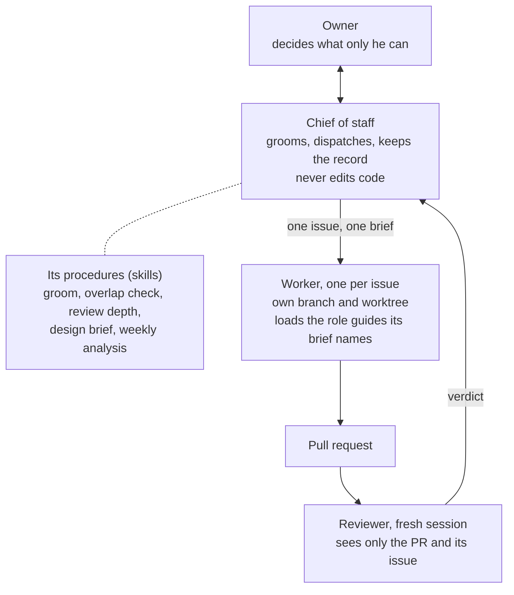
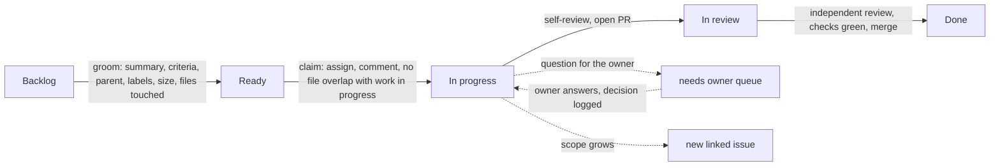
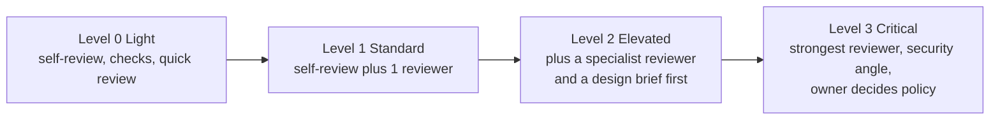
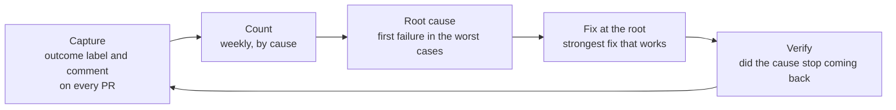

# Agent operating model

How the agent team is organized: who plans, who builds, who reviews, how much checking a change
gets, and how the team learns from its mistakes. It applies to every agent and human. The rules for
how a change reaches `main` are in [`AGENTS.md`](../../AGENTS.md); how work is planned and tracked is in
[`project-management.md`](project-management.md). The research behind this page, with its sources,
is on #685 and #721; each source is linked where it is used.

The owner talks to **one agent, the chief of staff**. Everything else happens behind it, and
everything it does is recorded on a GitHub issue. This page is the target. Each part is marked
**built** or **planned**; a planned part names the issue that builds it. Until a part is built, the
rules already in `AGENTS.md` and `project-management.md` stand.

**Order of work.** The knowledge layer (#712) is built first, then the team on this page.

## The owner's direction (summary, recorded on #685 and #721)

Sessions of 2026-11-04 (voice and text) and 2026-11-05 (Claude Code):

- One agent to talk to. An issue exists, is claimed and is In progress before any code changes; a
  reviewed, green merge closes it and moves it to Done. The five board columns stay.
- Every question, pushback and decision is a comment on the issue. Scope creep becomes a new issue.
- Questions for the owner wait in a queue and reach his phone.
- Design comes before building, the builders' standards are kept current, and a feedback loop fixes
  repeated failures at the root cause. Sources are official documentation and maintained open source.

Session of 2026-11-06 (Claude, text):

- A leaner team: the chief of staff, one temporary worker per issue, a fresh reviewer per PR.
- The role guides become skills a worker loads. The four helpers planned earlier (planner, design
  lead, review lead, process analyst) become procedures in the chief of staff's skill.
- More agents are added only if this proves too thin.
- Parallel work has no fixed number: whether issues touch the same files decides.

## 1. At a glance

## 2. Who gets a session

| Session        | Does                                                                                          | Capability                                          | Edits code?                  | Status                              |
| -------------- | --------------------------------------------------------------------------------------------- | --------------------------------------------------- | ---------------------------- | ----------------------------------- |
| Chief of staff | Talks to the owner; grooms; assigns one worker per issue; keeps the record; manages the queue | Strongest; high effort for grooming and issue text  | No. Issues and comments only | Partly, #695 piece one (2026-11-08) |
| Worker         | One issue, in its own branch and worktree, then it ends                                       | Standard, medium effort                             | Yes, in its own branch       | Partly                              |
| Reviewer       | Reviews one PR in a fresh session ([§5](#5-reviewers-in-a-fresh-session))                     | By level ([§6](#6-how-much-scrutiny-a-change-gets)) | No, it reports               | Partly                              |

Three kinds of session and no standing layer between them. A fourth, the scheduled sweep, only
labels and comments (planned, #697). [`CLAUDE.md`](../../CLAUDE.md) says which model each uses.
Partly built: the [role agents](../roles/README.md) and `pr-review` exist; #695 builds the rest.

**Why so few.** Several agents use about 15 times a chat's tokens, and coding has less parallel work
than research ([Anthropic](https://www.anthropic.com/engineering/multi-agent-research-system)). In a
test of 180 setups, more agents helped parallel work and made step-by-step work worse
([Google Research](https://research.google/blog/towards-a-science-of-scaling-agent-systems-when-and-why-agent-systems-work/)).
What holds up is one coordinator, read-only helpers and a reviewer with no shared context
([Cognition](https://cognition.com/blog/multi-agents-working)).

**When to add an agent.** A procedure or a role guide becomes its own agent only when its work is
self-contained, needs different permissions or truly runs in parallel, and a comparison on real
issues with and without it, recorded on an issue, shows it helps. Each part of this setup is a guess
about what a model can't do alone, so it is re-tested as models change
([Anthropic](https://anthropic.com/engineering/harness-design-long-running-apps)).

## 3. Skills, not agents

A separate agent is for isolated side work; the knowledge and checklists a task needs belong in the
session doing it
([Claude Code](https://claude.com/blog/steering-claude-code-skills-hooks-rules-subagents-and-more)).
An issue that touches a page, its CMS fields and its metadata needs all three guides in one head.
The brief names the guides and notes to load, because instructions an agent has to choose to open
are often skipped ([Vercel](https://vercel.com/blog/agents-md-outperforms-skills-in-our-agent-evals)).

| What                                    | Who loads it     | Covers                                                                                                                 | Status                                                                        |
| --------------------------------------- | ---------------- | ---------------------------------------------------------------------------------------------------------------------- | ----------------------------------------------------------------------------- |
| The twelve role guides                  | The worker       | Design (UX, UI), implementation (backend, CMS, frontend, media, SEO), content (content, events, legal), operations, QA | Guides: built                                                                 |
| Groom, overlap check, dispatch brief    | Chief of staff   | A Ready issue a worker can follow; no shared files or hot spots; a brief with the objective, done, sources, boundaries | Built, #695 piece one                                                         |
| Review depth                            | Chief of staff   | A lookup in the table in [§6](#6-how-much-scrutiny-a-change-gets), not an agent                                        | Built, #695 piece one (the lookup; the levels take effect with a later piece) |
| Design brief, standards upkeep          | Chief of staff   | A short design on the issue before new UI is built; root-cause fixes proposed as PRs                                   | Planned, #696                                                                 |
| Weekly analysis                         | Chief of staff   | The feedback loop in [§7](#7-the-feedback-loop)                                                                        | Planned, #698                                                                 |
| Knowledge notes and generated reference | Worker, reviewer | What a module does, its screens and data, its content types and shared components                                      | Planned, #712                                                                 |

**What a guide owns is unchanged.** Implementation: code that follows the architecture and the
[guard rails](../guidelines/guard-rails.md), inside the issue's declared files. Content: posts,
events and legal pages in the [brand voice](../guidelines/brand-voice.md); it may only propose
changes to the voice or the money and politics wording. Operations: CI/CD, the server and deploys,
with an `infra` issue before a server change. Guard rails, guidelines and role guides are policy:
the owner decides them, and an agent never edits its own rules ([`AGENTS.md`](../../AGENTS.md),
step 3). Workers build to the guard rails, the architecture and the open standards the repo follows
(WCAG 2.1 AA, structured data, Core Web Vitals,
[native first](../guidelines/development.md#native-first-then-plugins-then-our-code)).

## 4. How an issue moves

- **Issue first, claimed, In progress, before the first commit.** The chief of staff assigns; one
  dispatcher means two agents can't win the same issue, because GitHub has no atomic claim
  ([REST assignees](https://docs.github.com/en/rest/issues/assignees)). In review and Done move on
  their own ([project-management](project-management.md#the-board)). Built: #693.
- **Every step leaves a comment** under a fixed header the chief of staff and scripts can find:
  `### [STEP]`, `[DECISION]`, `[QUESTION]`, `[PUSHBACK]` or `[SCOPE]`, followed by context, the
  decision or question, why, and `Owner needed: yes/no`. A convention, not a GitHub feature. Built: #693.
- **Owner questions** get the `needs owner` label and one plain question with options and a
  recommendation ([`project-tracking`](../../.agents/skills/project-tracking/SKILL.md) §3). Silence
  is never a yes: the issue [waits for owner](project-management.md#waits-for-owner). A session
  starts with the chief of staff listing them, oldest first, at most seven, one line each. The
  label is the queue. Built: the list, in the `chief-of-staff` skill (#695 piece one). Planned: the
  phone, #697.
- **Scope creep** becomes a new issue linked with a `[SCOPE]` comment. The current PR does not widen.
- **Parallel work.** More than one issue may be In progress only if the files each declares, and
  the shared hot spots, don't overlap. There is no fixed number
  ([the rule](project-management.md#grooming-and-work-in-progress); built #693, changed #721).
  Parallel agents work when each owns different files ([agent teams](https://code.claude.com/docs/en/agent-teams))
  and the tests are strong ([Anthropic](https://www.anthropic.com/engineering/building-c-compiler)).
  Dependent PRs go on a native stack ([`stacked-prs`](../../.agents/skills/stacked-prs/SKILL.md)).
- **Scheduled check.** Every open issue is checked on a schedule: duplicate bugs get a label and are
  closed after three days without objection; anything else that looks obsolete gets `proposed-close`
  for the owner; an old idea is never closed by an agent, it gets `needs owner`. The parts that
  follow fixed rules run as a script with no model. Planned: #697.

## 5. Reviewers in a fresh session

The author never reviews its own change, and a reviewer never inherits the author's reasoning. It
starts in a new session with only the PR, its issue and the repository, so it sees what the diff
says, not what the author meant. The author still runs
[`self-review`](../../.agents/skills/self-review/SKILL.md) first; that is not the independent review.

This is the evaluator-optimizer pattern, which fits when there are clear evaluation criteria
([Anthropic](https://www.anthropic.com/engineering/building-effective-agents)); here the criteria
are the guard rails, the guidelines and the issue's acceptance criteria. Google's reviewers favor
approving once a change definitely improves the code's health, and check design first
([Google](https://google.github.io/eng-practices/review/reviewer/standard.html)).

| Perspective                | Checks                                                                              | Procedure                                                                                                        | Status |
| -------------------------- | ----------------------------------------------------------------------------------- | ---------------------------------------------------------------------------------------------------------------- | ------ |
| Correctness and process    | Issue link, scope, correctness, guard rails, Self-review truthfulness, policy flags | [`pr-review`](../../.agents/skills/pr-review/SKILL.md)                                                           | Built  |
| Design and accessibility   | Six widths, light and dark, spacing, alignment, WCAG                                | [`visual-design-review`](../../.agents/skills/visual-design-review/SKILL.md), [QA role](../roles/qa-reviewer.md) | Built  |
| Security                   | Auth, access rules, input, secrets, packages                                        | [security guideline](../guidelines/security.md), `pr-review`                                                     | Partly |
| Content accuracy and voice | Sources, dates, money and politics wording, brand voice                             | [brand voice](../guidelines/brand-voice.md), [content role](../roles/content-lead.md)                            | Partly |
| Process fit                | Does the diff match the owner's summary on the issue                                | `pr-review` policy section                                                                                       | Built  |

A review ends with the verdict **Ready to merge**, **Changes requested** or **Waits for owner**,
and a reviewer may raise the scrutiny level but never lower it. The chief of staff picks the
perspectives from the level; they run inside the one reviewer session as short-lived subagents, the
way `self-review` works (planned, #695). A check of every behavior change against the knowledge
layer joins with #717.

## 6. How much scrutiny a change gets

**Status: planned (#695).** Today review depth follows the one rule in [`CLAUDE.md`](../../CLAUDE.md) (#522); this scale takes effect when #695 merges.

Scrutiny costs time and tokens, so it follows risk. The level is the highest one that matches;
the author proposes it, the reviewer may raise it. Google's guidance names the same judgment: some
code deserves more careful scrutiny, such as security and privacy, concurrency and user-visible
changes ([Google](https://google.github.io/eng-practices/review/reviewer/looking-for.html)). The
four levels below are this repo's own scale (inference).

| Level          | When                                                                                                                                                                                                          | Review                                                                                                                                                                                  |
| -------------- | ------------------------------------------------------------------------------------------------------------------------------------------------------------------------------------------------------------- | --------------------------------------------------------------------------------------------------------------------------------------------------------------------------------------- |
| **0 Light**    | Wording, link and fact fixes in docs; patch-level dependency updates; test-only changes                                                                                                                       | Self-review (always required, [guard rails](../guidelines/guard-rails.md) rule 6), required checks and one quick standard review. No extra scrutiny beyond that                         |
| **1 Standard** | Ordinary code, content and UI inside one module                                                                                                                                                               | Self-review, then one independent review                                                                                                                                                |
| **2 Elevated** | Shared components (`shared-component`); CMS fields and blocks; public facts about money, politics or dates; anything several pages use                                                                        | Level 1, plus the specialist perspectives that apply (design, accessibility, content accuracy); a design brief first for new UI                                                         |
| **3 Critical** | Sign-in and accounts; access rules and roles; migrations; deploys and server scripts; secrets; the process itself (`AGENTS.md`, `.agents/`, `.claude/`, `.github/`, guidelines, role guides, `docs/process/`) | For code: the strongest reviewer at high effort, plus a security perspective. For policy files: a check against the owner's dated summary, and **Waits for owner** if it goes beyond it |

Where extra scrutiny does **not** apply: documentation wording, dependency patches that pass the
checks, test-only changes, seed data. Where it always does: anything that can lock a resident out,
expose their data, move money wording, or let an agent change its own rules.

## 7. The feedback loop

1. **Capture.** When work is wrapped up the author adds `outcome: clean` or one `fail:` label
   (spec misread, convention, test gap, CI, security, scope creep, process, tooling) and a
   comment: Outcome, Why, Prevention. Planned: #698.
2. **Count and find the root.** Weekly, as a procedure, the chief of staff counts the labels, reads
   the worst cases, notes the **first** failure in each, groups them and fixes the largest group
   ([Husain and Shankar](https://hamel.dev/blog/posts/evals-faq/)). Blameless: fix the system,
   never blame an agent ([Google SRE](https://sre.google/sre-book/postmortem-culture/)).
3. **Fix with the strongest tool that works.** In this order: a test, lint rule or CI check; then
   a hook or permission rule; then a written rule, a skill update or a shared component. A written
   rule alone is context, not enforcement ([Claude Code](https://code.claude.com/docs/en/features-overview)).
   The same mistake twice means a rule; the same procedure a third time means a skill.
4. **Bottlenecks.** The same weekly report shows time in each board column, time waiting for the
   owner, review rounds per PR, slow or flaky checks, and tokens per merged PR. A step that costs
   many hours a week and follows fixed rules becomes automation.
5. **Reinforce what works.** `outcome: clean` PRs are kept as examples. A pattern becomes a skill
   example only after three clean PRs and a with/without test that shows it helps
   ([skill best practices](https://platform.claude.com/docs/en/agents-and-tools/agent-skills/best-practices)).
   This does not delay reuse: repeated code or UI becomes a shared component at its second use,
   in that same PR ([guard rails](../guidelines/guard-rails.md), rule 1).
6. **Limits.** At most three fix PRs a week. The chief of staff proposes; agents never merge a
   change to their own guardrails, which the owner decides. Measures, read over four weeks or more:
   first-pass clean rate, rework within 14 days, owner corrections per PR, and whether a fixed
   cause comes back.

## 8. What is built and what is next

| Part                                                            | Status  | Where                          |
| --------------------------------------------------------------- | ------- | ------------------------------ |
| Board, issue flow, role guides, skills, hooks, checks           | Built   | [`AGENTS.md`](../../AGENTS.md) |
| This page and the visual plan                                   | Built   | #692, #721                     |
| Issue fields, comment header, labels, claim, parallel rule      | Built   | #693, #721                     |
| Code owners for the rule files                                  | Built   | #694                           |
| Knowledge layer: lean context, notes, generated reference, sync | Planned | #712, first                    |
| Chief of staff session, skill, overlap check (piece one)        | Built   | #695, 2026-11-08               |
| One worker, one reviewer; guides as skills; §6 takes effect     | Planned | #695, later pieces             |
| Design brief and standards upkeep as procedures                 | Planned | #696                           |
| Phone, push and the daily sweep (Windows)                       | Planned | #697                           |
| Feedback loop                                                   | Planned | #698                           |

The order is fixed by what each needs: #712, then #695, then #696 to #698. The chief of staff's
limits are checked statically; the refusals are tried by hand ([manual test](chief-of-staff-manual-test.md), not run).
