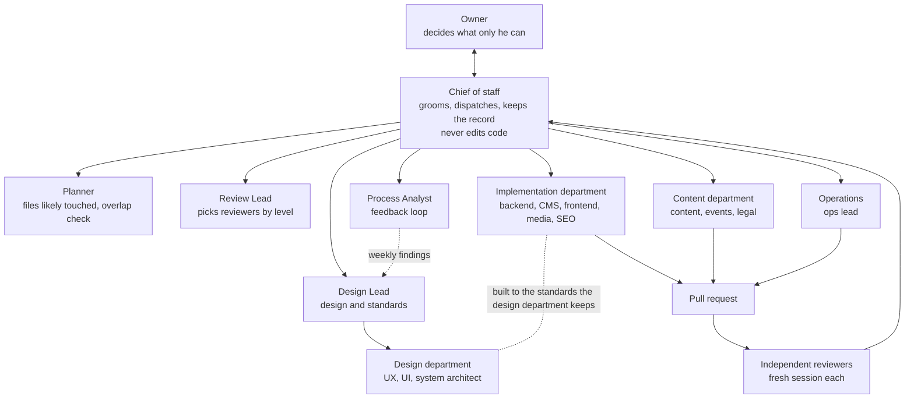
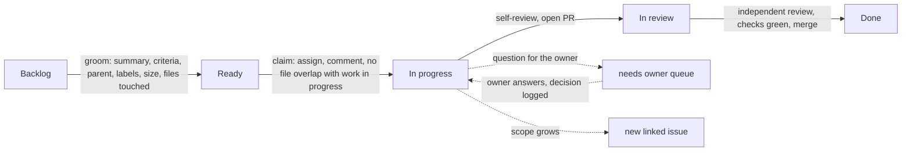
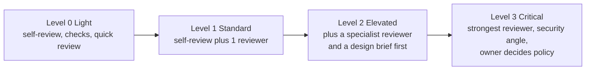
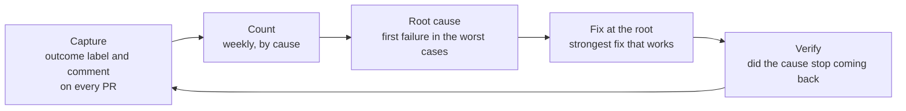

# Agent operating model

How the agent team is organized: who plans, who builds, who reviews, how much checking a change
gets, and how the team learns from its mistakes. It applies to every agent and human. The rules for
how a change reaches `main` are in [`AGENTS.md`](../../AGENTS.md); how work is planned and tracked is in
[`project-management.md`](project-management.md). The research behind this page, with its sources,
is on #685.

The owner talks to **one agent, the chief of staff**. Everything else happens behind it, and
everything it does is recorded on a GitHub issue. This page is the target. Each part is marked
**built** or **planned**; a planned part names the sub-issue of #685 that builds it. Until a part is
built, the rules already in `AGENTS.md` and `project-management.md` stand.

## The owner's direction (summary; 2026-11-04 voice and text sessions, 2026-11-05 Claude Code session, recorded on #685)

- One agent to talk to; it uses helpers, and the helpers use workers with narrow jobs.
- An issue exists, is claimed by a named agent and is In progress before any code changes. After a
  reviewed, green merge the issue closes and moves to Done. The five board columns stay.
- Every question, pushback and decision is a comment on the issue. Scope creep becomes a new issue.
- Parallel work is fine when issues don't touch the same files.
- Questions for the owner wait in a queue and reach his phone.
- A design department designs, and keeps improving how the implementation department builds.
- A feedback loop fixes repeated failures at the root cause.
- Sources for decisions are official documentation and widely used, maintained open source.

## 1. At a glance

## 2. Levels

| Level          | Does                                                                                          | Capability                                          | Edits code?                  | Status  |
| -------------- | --------------------------------------------------------------------------------------------- | --------------------------------------------------- | ---------------------------- | ------- |
| Chief of staff | Talks to the owner; grooms; assigns one worker per issue; keeps the record; manages the queue | Strongest, high effort                              | No. Issues and comments only | Planned |
| Helpers        | Planner, Design Lead, Review Lead, Process Analyst. Called when needed, read-only             | Strongest                                           | No                           | Planned |
| Workers        | The role agents in [`docs/roles/`](../roles/README.md). One issue each, own branch            | Standard, medium effort                             | Yes, in their own branch     | Built   |
| Reviewers      | Review one PR from one angle, in a fresh session ([§5](#5-reviewers-in-a-fresh-session))      | By level ([§6](#6-how-much-scrutiny-a-change-gets)) | No, they report              | Partly  |

Why helpers are on-demand and read-only: the research found no source showing a standing manager
layer improves results, and multi-agent work costs about 15 times a chat's tokens, with most coding
tasks having less parallel work than research does
([Anthropic](https://www.anthropic.com/engineering/multi-agent-research-system)). Start with the
simplest arrangement and add agents only where work truly runs in parallel
([Anthropic](https://www.anthropic.com/engineering/building-effective-agents)). Each helper brief
states the objective, the output format, the sources to use and the boundaries; vague briefs
caused duplicated work in
[Anthropic's own system](https://www.anthropic.com/engineering/multi-agent-research-system).

Capability levels are tool-neutral. [`CLAUDE.md`](../../CLAUDE.md) says which model each level uses.

## 3. Departments

| Department         | Members                                                                                 | Owns                                                                                                                                                      | May only propose                                                   |
| ------------------ | --------------------------------------------------------------------------------------- | --------------------------------------------------------------------------------------------------------------------------------------------------------- | ------------------------------------------------------------------ |
| **Design**         | Design Lead (planned, #696), UX designer, UI designer, system architect (planned, #696) | Designs and specs before building anything new and visible; the architecture and component set; keeping the implementation department's standards current | Changes to guard rails, guidelines, role guides: the owner decides |
| **Implementation** | Backend, CMS and frontend engineers; media manager; SEO specialist                      | Code that follows the architecture, the guard rails and the standards below                                                                               | Anything outside its issue's declared files                        |
| **Content**        | Content lead, events manager, legal and compliance                                      | Posts, events, resources, legal pages, in the [brand voice](../guidelines/brand-voice.md)                                                                 | Changes to the voice or the money and politics wording             |
| **Operations**     | Ops lead                                                                                | CI/CD, the server, deploys, backups, server scripts                                                                                                       | Server changes need an `infra` issue first                         |

**What the design department does for the implementation department.** It does not write feature
code. It (1) designs before building, for anything new that residents see or any new structure,
so implementers receive a short brief and not a blank page; (2) keeps the standards current:
the architecture, the shared component set, the guidelines and the role guides, aligned with open
standards and industry practice; and (3) reads the feedback loop's findings and turns a repeated
failure into a design change at the root: a shared component, a test, a lint rule, a clearer
guideline ([§7](#7-the-feedback-loop)). It proposes these as pull requests. Guard rails, guidelines
and role guides are policy, so the owner decides them and an agent never edits its own rules
([`AGENTS.md`](../../AGENTS.md), step 3).

**The standards implementers build to.** The guard rails ([`guard-rails.md`](../guidelines/guard-rails.md)),
the architecture, and the open standards the repo already follows: WCAG 2.1 AA, structured data,
Core Web Vitals, Payload's and Next.js's documented practice
([native first](../guidelines/development.md#native-first-then-plugins-then-our-code)). The system
architect may propose adding others, such as a security verification standard, when the feedback loop
shows a recurring gap (inference). Industry standards come from the vendors' own documentation first,
then widely used, maintained open source.

## 4. How an issue moves

- **Issue first, claimed, In progress, before the first commit.** The chief of staff assigns; one
  dispatcher means two agents can't win the same issue, because GitHub has no atomic claim
  ([REST assignees](https://docs.github.com/en/rest/issues/assignees)). In review and Done move on
  their own ([project-management](project-management.md#the-board)). Built: #693.
- **Every step leaves a comment** under a fixed header the chief of staff and scripts can find:
  `### [STEP]`, `[DECISION]`, `[QUESTION]`, `[PUSHBACK]` or `[SCOPE]`, followed by context, the
  decision or question, why, and `Owner needed: yes/no`. A convention, not a GitHub feature. Built: #693.
- **Owner questions** get the `needs owner` label and one plain question with options and a
  recommendation, as in [`project-tracking`](../../.agents/skills/project-tracking/SKILL.md) §3.
  Silence is never a yes: the issue waits ([waits for owner](project-management.md#waits-for-owner)).
  At the start of a session the chief of staff lists them, oldest first, at most seven, one line each.
  The label is the queue. Planned: #695, #697.
- **Scope creep** becomes a new issue, linked to the original with a `[SCOPE]` comment. The current
  PR does not widen.
- **Parallel work.** More than one issue may be In progress only if the files each declares, and
  the shared hot spots (listed in project-management), don't overlap, up to the
  cap in project-management. Anthropic's guidance for parallel agents is that each owns a different set of files
  ([agent teams](https://code.claude.com/docs/en/agent-teams)). Dependent PRs go on a native
  stack ([`stacked-prs`](../../.agents/skills/stacked-prs/SKILL.md)). The rule is in
  [project-management](project-management.md#grooming-and-work-in-progress) (built: #693).
- **Scheduled check.** Every open issue is checked on a schedule: duplicate bugs get a label and are
  closed after three days without objection; anything else that looks obsolete gets `proposed-close`
  for the owner; an old idea is never closed by an agent, it gets `needs owner`. Planned: #697.

## 5. Reviewers in a fresh session

The author never reviews its own change, and a reviewer never inherits the author's reasoning.
A reviewer starts with only the PR, its issue and the repository, in a new session. Reading the
change cold is the point: it sees what the diff says, not what the author meant. The author still
runs [`self-review`](../../.agents/skills/self-review/SKILL.md) first; that catches the easy things
and does not count as the independent review.

This is the evaluator-optimizer pattern, which fits when there are clear evaluation criteria
([Anthropic](https://www.anthropic.com/engineering/building-effective-agents)); here the criteria
are the guard rails, the guidelines and the issue's acceptance criteria. Google's reviewers favor
approving once a change definitely improves the code's health, and treat design as the most
important thing to check ([Google](https://google.github.io/eng-practices/review/reviewer/standard.html),
[what to look for](https://google.github.io/eng-practices/review/reviewer/looking-for.html)).

| Perspective                | Checks                                                                              | Procedure                                                                                                        | Status |
| -------------------------- | ----------------------------------------------------------------------------------- | ---------------------------------------------------------------------------------------------------------------- | ------ |
| Correctness and process    | Issue link, scope, correctness, guard rails, Self-review truthfulness, policy flags | [`pr-review`](../../.agents/skills/pr-review/SKILL.md)                                                           | Built  |
| Design and accessibility   | Six widths, light and dark, spacing, alignment, WCAG                                | [`visual-design-review`](../../.agents/skills/visual-design-review/SKILL.md), [QA role](../roles/qa-reviewer.md) | Built  |
| Security                   | Auth, access rules, input, secrets, packages                                        | [security guideline](../guidelines/security.md), `pr-review`                                                     | Partly |
| Content accuracy and voice | Sources, dates, money and politics wording, brand voice                             | [brand voice](../guidelines/brand-voice.md), [content role](../roles/content-lead.md)                            | Partly |
| Process fit                | Does the diff match the owner's summary on the issue                                | `pr-review` policy section                                                                                       | Built  |

A review ends with the verdict **Ready to merge**, **Changes requested** or **Waits for owner**,
and a reviewer may raise the scrutiny level but never lower it. The review lead picks the
perspectives from the level. Planned: #695.

## 6. How much scrutiny a change gets

**Status: planned (#695).** Today review depth follows the one rule in [`CLAUDE.md`](../../CLAUDE.md) (#522); this scale takes effect when #695 merges.

Scrutiny costs time and tokens, so it follows risk. The level is the highest one that matches;
the author proposes it, the reviewer may raise it. Google's guidance names the same judgment: some
code deserves more careful scrutiny, such as security and privacy, concurrency and user-visible
changes ([Google](https://google.github.io/eng-practices/review/reviewer/looking-for.html)). The
four levels below are this repo's own scale (inference).

| Level          | When                                                                                                                                                                                                          | Review                                                                                                                                                                                  |
| -------------- | ------------------------------------------------------------------------------------------------------------------------------------------------------------------------------------------------------------- | --------------------------------------------------------------------------------------------------------------------------------------------------------------------------------------- |
| **0 Light**    | Wording, link and fact fixes in docs; patch-level dependency updates; test-only changes                                                                                                                       | Self-review (always required, [guard rails](../guidelines/guard-rails.md) rule 6), required checks and one quick standard review. No extra scrutiny beyond that                         |
| **1 Standard** | Ordinary code, content and UI inside one module                                                                                                                                                               | Self-review, then one independent review                                                                                                                                                |
| **2 Elevated** | Shared components (`shared-component`); CMS fields and blocks; public facts about money, politics or dates; anything several pages use                                                                        | Level 1, plus the specialist perspectives that apply (design, accessibility, content accuracy); a design brief first for new UI                                                         |
| **3 Critical** | Sign-in and accounts; access rules and roles; migrations; deploys and server scripts; secrets; the process itself (`AGENTS.md`, `.agents/`, `.claude/`, `.github/`, guidelines, role guides, `docs/process/`) | For code: the strongest reviewer at high effort, plus a security perspective. For policy files: a check against the owner's dated summary, and **Waits for owner** if it goes beyond it |

Where extra scrutiny does **not** apply: documentation wording, dependency patches that pass the
checks, test-only changes, seed data. Where it always does: anything that can lock a resident out,
expose their data, move money wording, or let an agent change its own rules.

## 7. The feedback loop

1. **Capture.** When work is wrapped up the author adds `outcome: clean` or one `fail:` label
   (spec misread, convention, test gap, CI, security, scope creep, process, tooling) and a
   comment: Outcome, Why, Prevention. Planned: #698.
2. **Count and find the root.** Weekly, the process analyst counts the labels and reads what
   happened in the worst cases. It notes the **first** failure in each, groups them into a few
   categories, and fixes the largest group
   ([Husain and Shankar](https://hamel.dev/blog/posts/evals-faq/)). Blameless: fix the system,
   never blame an agent ([Google SRE](https://sre.google/sre-book/postmortem-culture/)).
3. **Fix with the strongest tool that works.** In this order: a test, lint rule or CI check; then
   a hook or permission rule; then a written rule, a skill update or a shared component. A written
   rule alone is context, not enforcement ([Claude Code](https://code.claude.com/docs/en/features-overview)).
   The same mistake twice means a rule; the same procedure a third time means a skill.
4. **Bottlenecks.** The same weekly report shows time in each board column, time waiting for the
   owner, review rounds per PR and slow or flaky checks. A step that costs many hours a week and
   follows fixed rules becomes automation.
5. **Reinforce what works.** `outcome: clean` PRs are kept as examples. A pattern becomes a skill
   example only after three clean PRs and a with/without test that shows it helps
   ([skill best practices](https://platform.claude.com/docs/en/agents-and-tools/agent-skills/best-practices)).
   This does not delay reuse: repeated code or UI becomes a shared component at its second use,
   in that same PR ([guard rails](../guidelines/guard-rails.md), rule 1).
6. **Limits.** At most three fix PRs a week. The process analyst and the design department
   propose; agents never merge a change to their own guardrails, which the owner decides.
   Measures: first-pass clean rate, rework within 14 days, owner corrections per PR, and whether a
   fixed cause comes back. Read trends over four weeks or more.

## 8. What is built and what is next

| Part                                                       | Status  | Where                          |
| ---------------------------------------------------------- | ------- | ------------------------------ |
| Board, issue flow, role agents, skills, hooks, checks      | Built   | [`AGENTS.md`](../../AGENTS.md) |
| This page and the visual plan                              | This PR | #692                           |
| Issue fields, comment header, labels, claim, parallel rule | Built   | #693                           |
| Code owners and chief of staff limits                      | Planned | #694                           |
| Chief of staff, helpers, reviewer perspectives             | Planned | #695                           |
| Design department                                          | Planned | #696                           |
| Phone, push and the daily sweep (Windows)                  | Planned | #697                           |
| Feedback loop                                              | Planned | #698                           |
| Scrutiny levels as one scale (§6)                          | Planned | #695                           |

The order is fixed by what each needs: #692, then #693 and #694, then #695, then #696 to #698.

## Sources

Vendor documentation first: [Anthropic engineering](https://www.anthropic.com/engineering/building-effective-agents),
[Claude Code subagents](https://code.claude.com/docs/en/sub-agents),
[model configuration](https://code.claude.com/docs/en/model-config),
[GitHub issues and projects](https://docs.github.com/en/issues/planning-and-tracking-with-projects/automating-your-project/using-the-built-in-automations),
[Google engineering practices](https://google.github.io/eng-practices/review/reviewer/standard.html),
[Google SRE](https://sre.google/sre-book/postmortem-culture/). The full list is on #685.
