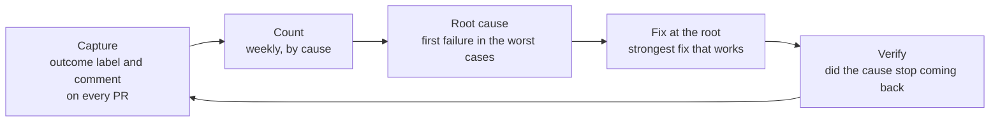

# The feedback loop

Part of the [agent operating model](agent-operating-model.md): how repeated failures are found and
fixed at the root. Status: planned (#698).

1. **Capture.** When work is wrapped up the author adds `outcome: clean` or one `fail:` label
   (spec misread, convention, test gap, CI, security, scope creep, process, tooling) and a
   comment: Outcome, Why, Prevention. Planned: #698.
2. **Count and find the root.** Weekly, as a procedure, the chief of staff counts the labels, reads
   the worst cases, notes the **first** failure in each, groups them and fixes the largest group
   ([Husain and Shankar](https://hamel.dev/blog/posts/evals-faq/)). Blameless: fix the system,
   never blame an agent ([Google SRE](https://sre.google/sre-book/postmortem-culture/)).
3. **Fix with the strongest tool that works.** In this order: a test, lint rule or CI check; then
   a hook or permission rule; then a written rule, a skill update or a shared component. A written
   rule alone is context, not enforcement ([Claude Code](https://code.claude.com/docs/en/features-overview)).
   The same mistake twice means a rule; the same procedure a third time means a skill.
4. **Bottlenecks.** The same weekly report shows time in each board column, time waiting for the
   owner, review rounds per PR, slow or flaky checks, and tokens per merged PR. A step that costs
   many hours a week and follows fixed rules becomes automation.
5. **Reinforce what works.** `outcome: clean` PRs are kept as examples. A pattern becomes a skill
   example only after three clean PRs and a with/without test that shows it helps
   ([skill best practices](https://platform.claude.com/docs/en/agents-and-tools/agent-skills/best-practices)).
   This does not delay reuse: repeated code or UI becomes a shared component at its second use,
   in that same PR ([guard rails](../guidelines/guard-rails.md), rule 1).
6. **Limits.** At most three fix PRs a week. The chief of staff proposes; agents never merge a
   change to their own guardrails, which the owner decides. Measures, read over four weeks or more:
   first-pass clean rate, rework within 14 days, owner corrections per PR, and whether a fixed
   cause comes back.
